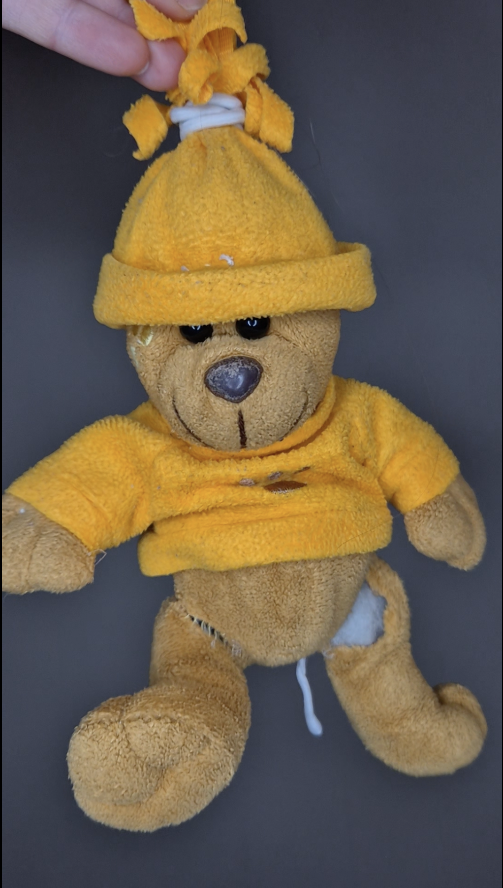

# SMS-bear
A teddy bear which sends an SMS when a button is pushed via 46elks API and ESP32-C3 Supermini.

Code written by Claude in MicroPython. I used Thonny as code editor. 

##FIRST TIME USING THONNY?
1. (Install) + Open Thonny
2. Connect ESP32-C3 SuperMini by USB-cable (make sure cable is capable of data transferring)
3. Run -> Configure Interpreter
4. Click Install or update MicroPython (esp tool)
5. Installing MicroPython
   * Target port: Select /dev/cu.usbmodem101 or similar that shows up (that is your ESP32).
   * MicroPython Familly: ESP32-C3
   * Variant: espressif
   * Version: (Latest)
6. Keep following next set of instructions in "NOT FIRST TIME USING THONNY?"

##NOT FIRST TIME USING THONNY?
1. Plug in your ESP32
2. Select /dev/cu.usbmodem101 or similar that shows up (that is your ESP32).
3. Enter you API credentials and WiFi name and password
4. Upload main.py, hit play to test
5. Save to your Micro controller

##SMS API
SMS API is 46elks.
1. Create an account
2. ELKS_USER is username
3. ELKS_PASS is password
4. SMS_FROM can either be the phone number (include "+[prefix]") you registered with or a sender ID which is 3-11 characters (i.e Nallen). If sender ID is used – recipient cannot reply to SMS. Cannot use accented letters, such as Å, Ä, Ö, or space.
5. SMS_TO is what number you want to send SMS to. Include "+[prefix]".
6. SMS_TEXTS is the SMS that can be randomly sent. 4 messages pre-set in main.py.
7. Use the cooldown to not accidentally send a lot of SMS which costs money.

##Schematics:
| Arcade button                    | ESP32-C3 SuperMini | Comment                       |
|----------------------------------|--------------------|-------------------------------|
| Pin 1 (COM or NO)                | GPIO4              | Where main.py reads data from |
| Pin 2 (COM or NO)                | GND                | Ground                        |
| LED-pins                         | Don't connect      | Not used                      |

